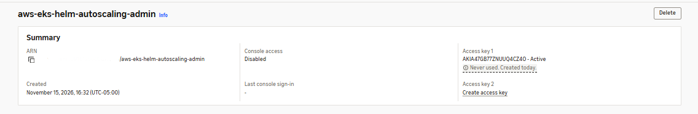
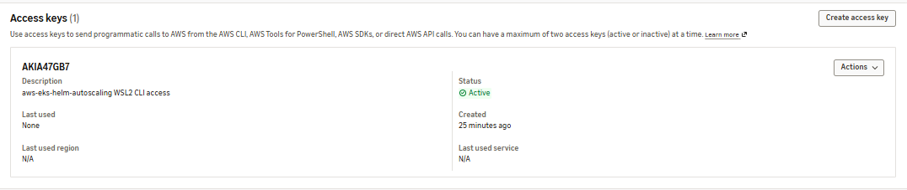

# aws-eks-helm-autoscaling

WordPress on Amazon EKS, deployed with Helm and autoscaled with a Horizontal Pod Autoscaler (HPA).

**Tools:** eksctl · kubectl · Helm · AWS (EKS, EC2, ELB, EBS, ACM) · GitHub

## Architecture

*Note: Solid borders represent the core build, while dashed borders represent planned Phase 2 upgrades.*

## Project Phases
1. VS Code, Git & GitHub
2. AWS Foundations
3. Kubernetes Concepts and Tools
4. Amazon EKS Cluster
5. WordPress with Helm
6. Autoscaling
7. Load Testing
8. Auth-Key Secret & EBS
9. HTTPS via ALB
10. Documentation, Polish & Comparison

> 🚧 In progress

---

## Phase 1: Environment Setup & Version Control
- Configured WSL2 Ubuntu development environment on Windows 11.
- Initialized Git version control with strict `.gitignore` security filters.
- Established a standardized project directory structure (`eksctl/`, `helm/`, `k8s/`, `scripts/`, `docs/`).
- Captured project folder structure and GitHub repository landing page documentation.

### Phase 1 Documentation

**Project Folder Structure (VS Code):**

**GitHub Repository Landing Page:**

---

## Phase 2: AWS Foundations
- Created dedicated project IAM user `aws-eks-helm-autoscaling-admin` in `us-east-1` with administrative privileges for infrastructure provisioning, avoiding root account usage.
- Generated programmatic access keys for `aws-eks-helm-autoscaling-admin` tagged for WSL2 CLI usage.
- Installed AWS CLI v2 inside WSL2 Ubuntu and verified authentication via `aws sts get-caller-identity`.
- Deployed an active AWS Budget (`aws-eks-helm-autoscaling-budget`) set to $10/month with an 80% email alert threshold.

### Phase 2 Documentation

**1. Dedicated IAM User Created:**

**2. Access Key Configured:**

**3. AWS CLI Authentication Verified:**

**4. AWS Budget Active ($10/mo):**

---

## Phase 3: Kubernetes Concepts and Tools
- Installed pinned versions of core CLI tools inside WSL2 Ubuntu: `kubectl v1.30.0`, `eksctl v0.180.0`, and `helm v3.14.0`.
- Installed `kind` (v0.22.0) and spun up a local Kubernetes cluster named `aws-eks-helm-autoscaling-local` for zero-cost practice.

### Phase 3 Documentation

**Core CLI Tools Installed & Verified (`kubectl`, `eksctl`, `helm`):**

**Local `kind` Cluster Operational (`kubectl cluster-info`):**

