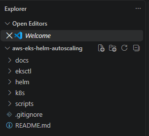
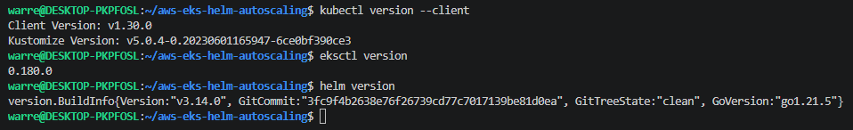
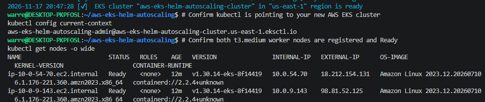
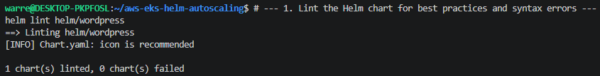
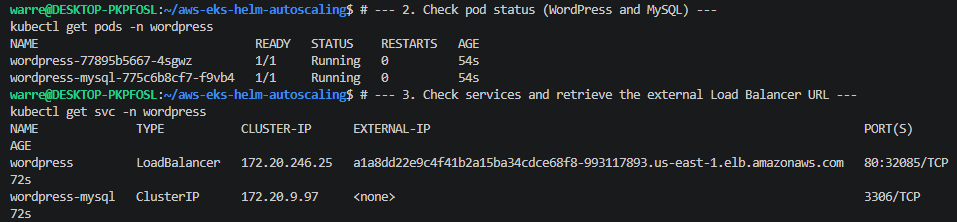
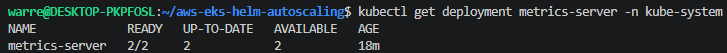
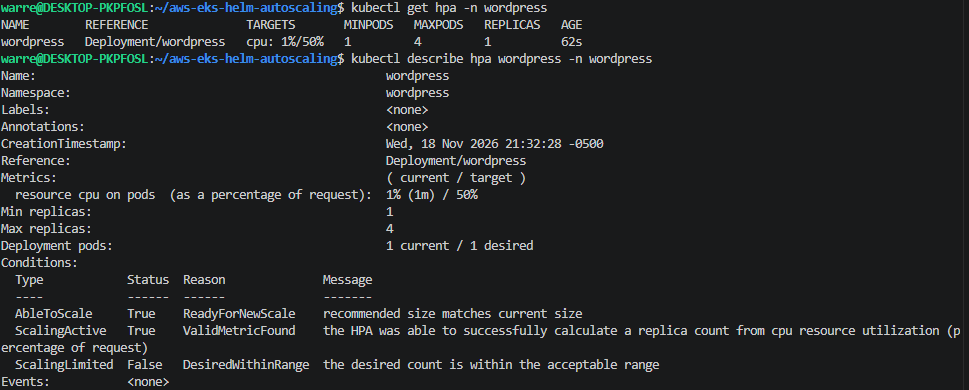

# aws-eks-helm-autoscaling

WordPress on Amazon EKS, deployed with Helm and autoscaled with a Horizontal Pod Autoscaler (HPA).

> **Simple version.** This project is the lean, cost-optimized build. For the production-grade version of the same app (Terraform, Multi-AZ RDS, EFS, CloudFront + WAF, Redis, CI/CD with OIDC), see [aws-eks-wordpress-enterprise](https://github.com/WJDVS/aws-eks-wordpress-enterprise).

**Tools:** eksctl · kubectl · Helm · AWS (EKS, EC2, ELB, EBS, ACM) · GitHub

## Architecture


*Note: Solid borders represent the core build, while dashed borders represent planned Phase 2 upgrades.*

## Project Phases
1. VS Code, Git & GitHub
2. AWS Foundations
3. Kubernetes Concepts and Tools
4. Amazon EKS Cluster
5. WordPress with Helm
6. Autoscaling
7. Load Testing
8. Auth-Key Secret & EBS
9. HTTPS via ALB
10. Documentation, Polish & Comparison

> 🚧 In progress

---

## Phase 1: Environment Setup & Version Control
- Configured WSL2 Ubuntu development environment on Windows 11.
- Initialized Git version control with strict `.gitignore` security filters.
- Established a standardized project directory structure (`eksctl/`, `helm/`, `k8s/`, `scripts/`, `docs/`).
- Captured project folder structure and GitHub repository landing page documentation.

### Phase 1 Documentation

**Project Folder Structure (VS Code):**



**GitHub Repository Landing Page:**


---

## Phase 2: AWS Foundations
- Created dedicated project IAM user `aws-eks-helm-autoscaling-admin` in `us-east-1` with administrative privileges for infrastructure provisioning, avoiding root account usage.
- Generated programmatic access keys for `aws-eks-helm-autoscaling-admin` tagged for WSL2 CLI usage.
- Installed AWS CLI v2 inside WSL2 Ubuntu and verified authentication via `aws sts get-caller-identity`.
- Deployed an active AWS Budget (`aws-eks-helm-autoscaling-budget`) set to $10/month with an 80% email alert threshold.

### Phase 2 Documentation

**1. Dedicated IAM User Created:**


**2. Access Key Configured:**


**3. AWS CLI Authentication Verified:**


**4. AWS Budget Active ($10/mo):**


---

- Practiced core Kubernetes objects (`Namespace`, `Deployment`, `Service`) on the local `kind` cluster by deploying and validating a test application within the `wordpress` namespace.

### Phase 3 Documentation

**Core CLI Tools Installed & Verified (`kubectl`, `eksctl`, `helm`):**



**Local `kind` Cluster Operational (`kubectl cluster-info`):**


**Core Kubernetes Objects Deployed & Verified (`kubectl get all -n wordpress`):**


---

## Phase 4: Amazon EKS Cluster
- Designed a declarative `eksctl` cluster blueprint (`eksctl/cluster-config.yaml`) targeting Kubernetes `v1.30` in `us-east-1` with NAT Gateways disabled (cost-optimized public subnet topology), governance tags, and a managed node group (`aws-eks-helm-autoscaling-nodes`) of two `t3.medium` worker nodes.

### Phase 4 Documentation

**1. Declarative `eksctl` Cluster Configuration (`eksctl/cluster-config.yaml`):**


- Provisioned the live Amazon EKS cluster (`aws-eks-helm-autoscaling-cluster`) via `eksctl` CloudFormation stacks in `us-east-1` and verified two `Ready` `t3.medium` worker nodes via `kubectl get nodes`.

**2. Live Amazon EKS Cluster Provisioned & Nodes Ready (`kubectl get nodes -o wide`):**



---

- Deployed the custom WordPress Helm release (`wordpress`) onto our live Amazon EKS cluster, scheduling MySQL and WordPress pods alongside an automatically provisioned AWS Classic Load Balancer.

### Phase 5 Documentation

**1. Kubernetes Database Secret Created & Verified (`kubectl get secret wordpress-db -n wordpress`):**


**2. Custom WordPress Helm Chart Linted & Validated (`helm lint helm/wordpress`):**



**3. WordPress Helm Release Deployed & Classic Load Balancer Active (`kubectl get pods / svc -n wordpress`):**



---

### Phase 6, Step 1: Installing and Verifying Metrics-Server
We verified that `metrics-server` is running with two ready replicas (`2/2`) in the `kube-system` namespace on our live EKS cluster (`aws-eks-helm-autoscaling-cluster`) and serving node telemetry.

```bash
kubectl get deployment metrics-server -n kube-system
kubectl top nodes
```



### Phase 6, Step 2: Configuring CPU Requests and Limits in Helm
We updated `helm/wordpress/values.yaml` and `helm/wordpress/templates/wordpress-deployment.yaml` to define CPU and memory requests (`100m` CPU, `128Mi` memory) and limits (`500m` CPU, `512Mi` memory) on the `wordpress` container, providing the CPU baseline required by the Horizontal Pod Autoscaler and upgrading the `wordpress` release in the `wordpress` namespace.

```bash
helm upgrade wordpress ./helm/wordpress --namespace wordpress
kubectl rollout status deployment/wordpress -n wordpress
kubectl get deployment wordpress -n wordpress -o yaml | grep -A 12 -i "resources:"
```


### Phase 6, Step 3: Deploying and Verifying the Horizontal Pod Autoscaler
We deployed a `HorizontalPodAutoscaler` targeting `Deployment/wordpress` in the `wordpress` namespace (`minReplicas: 1`, `maxReplicas: 4`, target average CPU utilization `50%`) and verified that it actively reads CPU metrics from `metrics-server` (`1% (1m) / 50%` with `ScalingActive: True`).

```bash
kubectl apply -f k8s/wordpress-hpa.yaml
kubectl get hpa -n wordpress
kubectl describe hpa wordpress -n wordpress
```

