# aws-eks-helm-autoscaling

WordPress on Amazon EKS, deployed with Helm and autoscaled with a Horizontal Pod Autoscaler (HPA).

> **Simple version.** This project is the lean, cost-optimized build. For the production-grade version of the same app (Terraform, Multi-AZ RDS, EFS, CloudFront + WAF, Redis, CI/CD with OIDC), see [aws-eks-wordpress-enterprise](https://github.com/WJDVS/aws-eks-wordpress-enterprise).

**Tools:** eksctl · kubectl · Helm · AWS (EKS, EC2, ELB, EBS, ACM) · GitHub

## Architecture


*Note: Solid borders represent the core build, while dashed borders represent planned Phase 2 upgrades.*

## Repository Structure

```text
aws-eks-helm-autoscaling/
├── docs/screenshots/          # Privacy-safe phase and step verification captures
├── eksctl/cluster-config.yaml # EKS cluster configuration
├── helm/wordpress/            # Helm chart for WordPress and MySQL
├── k8s/                       # StorageClass, HPA, Secret, test app, and ALB Ingress manifests
├── scripts/                   # Lab helper and verification scripts
└── README.md                  # Step-by-step engineering log and architecture guide
```

## Project Phases

1. Environment Setup & Version Control
2. AWS Foundations
3. Kubernetes Concepts & Tools
4. Amazon EKS Cluster
5. WordPress with Helm
6. Metrics & Horizontal Pod Autoscaling
7. Load Testing, Scale-Back-In & Ephemeral Storage
8. Persistent Storage (`gp3` EBS) & Auth-Key Secret
9. HTTPS via ALB
10. Documentation, Polish & Comparison

---

## Phase 1: Environment Setup & Version Control

- Configured a WSL2 Ubuntu development environment on Windows 11.
- Initialized Git version control with strict `.gitignore` security filters.
- Established a standardized project directory structure (`eksctl/`, `helm/`, `k8s/`, `scripts/`, `docs/`).

**Project Folder Structure (VS Code):**


**GitHub Repository Landing Page:**


---

## Phase 2: AWS Foundations

- Created a dedicated IAM user, `aws-eks-helm-autoscaling-admin`, with administrative privileges for provisioning in `us-east-1`, so the root account is never used.
- Generated programmatic access keys for that user, tagged for WSL2 CLI usage.
- Installed AWS CLI v2 inside WSL2 Ubuntu and verified authentication with `aws sts get-caller-identity`.
- Created an AWS Budget (`aws-eks-helm-autoscaling-budget`) of $10/month with an 80% email alert threshold.

**1. Dedicated IAM User Created:**


**2. Access Key Configured:**


**3. AWS CLI Authentication Verified:**


**4. AWS Budget Active ($10/mo):**


---

## Phase 3: Kubernetes Concepts & Tools

- Installed and verified the core CLI tools: `kubectl`, `eksctl`, and `helm`.
- Created a local `kind` cluster to practice Kubernetes without AWS costs.
- Deployed and validated a test application in the `wordpress` namespace using the core Kubernetes objects (`Namespace`, `Deployment`, `Service`).

**Core CLI Tools Installed & Verified (`kubectl`, `eksctl`, `helm`):**


**Local `kind` Cluster Operational (`kubectl cluster-info`):**

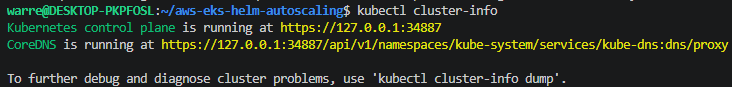

**Core Kubernetes Objects Deployed & Verified (`kubectl get all -n wordpress`):**

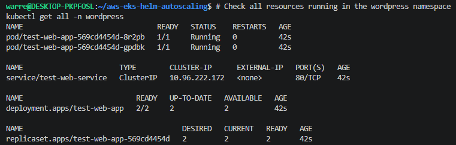

---

## Phase 4: Amazon EKS Cluster

- Designed a declarative `eksctl` blueprint (`eksctl/cluster-config.yaml`) targeting Kubernetes `v1.30` in `us-east-1`, with NAT Gateways disabled (a cost-optimized public-subnet topology), governance tags, and a managed node group (`aws-eks-helm-autoscaling-nodes`) of two `t3.medium` worker nodes.
- Provisioned the live cluster, `aws-eks-helm-autoscaling-cluster`, through `eksctl`-generated CloudFormation stacks and verified both worker nodes reported `Ready`.

**1. Declarative `eksctl` Cluster Configuration (`eksctl/cluster-config.yaml`):**

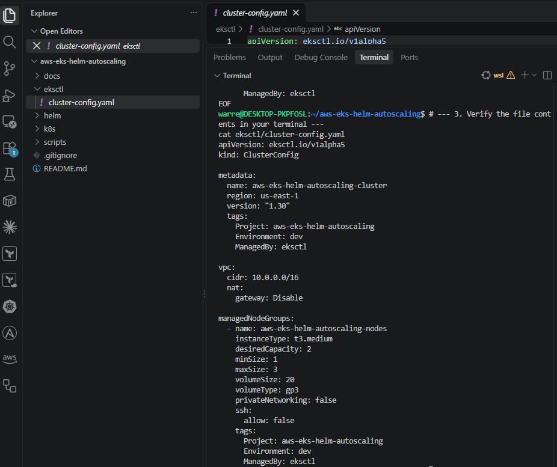

**2. Live Amazon EKS Cluster Provisioned & Nodes Ready (`kubectl get nodes -o wide`):**


---

## Phase 5: WordPress with Helm

- Stored the MySQL credentials in a Kubernetes `Secret` (`wordpress-db`) instead of hard-coding them in the chart.
- Linted and validated the custom WordPress Helm chart (`./helm/wordpress`).
- Deployed the `wordpress` Helm release to the EKS cluster, which scheduled the MySQL and WordPress pods and automatically provisioned an AWS Classic Load Balancer.

**1. Database Secret Created & Verified (`kubectl get secret wordpress-db -n wordpress`):**

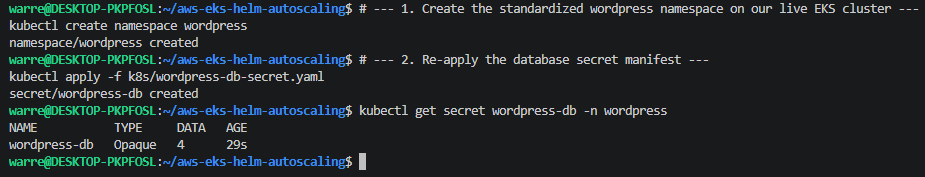

**2. Helm Chart Linted & Validated (`helm lint helm/wordpress`):**


**3. WordPress Release Deployed & Classic Load Balancer Active (`kubectl get pods / svc -n wordpress`):**


---

## Phase 6: Metrics & Horizontal Pod Autoscaling

### Phase 6, Step 1: Installing and Verifying Metrics-Server
Verified that `metrics-server` is running with two ready replicas (`2/2`) in `kube-system` and serving node telemetry. The HPA depends on these metrics to make scaling decisions.

```bash
kubectl get deployment metrics-server -n kube-system
kubectl top nodes
```


### Phase 6, Step 2: Configuring CPU Requests and Limits in Helm
Added CPU and memory requests (`100m` CPU, `128Mi` memory) and limits (`500m` CPU, `512Mi` memory) to the `wordpress` container in `helm/wordpress/values.yaml` and `templates/wordpress-deployment.yaml`, then upgraded the release. The CPU request is the baseline the HPA measures utilization against.

```bash
helm upgrade wordpress ./helm/wordpress --namespace wordpress
kubectl rollout status deployment/wordpress -n wordpress
kubectl get deployment wordpress -n wordpress -o yaml | grep -A 12 -i "resources:"
```

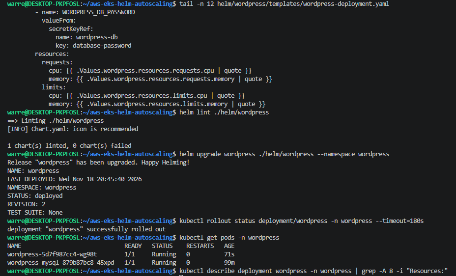

### Phase 6, Step 3: Deploying and Verifying the Horizontal Pod Autoscaler
Deployed a `HorizontalPodAutoscaler` targeting `Deployment/wordpress` (`minReplicas: 1`, `maxReplicas: 4`, target average CPU `50%`) and confirmed it was reading live metrics (`1% (1m) / 50%`, `ScalingActive: True`).

```bash
kubectl apply -f k8s/wordpress-hpa.yaml
kubectl get hpa -n wordpress
kubectl describe hpa wordpress -n wordpress
```


### Phase 6, Step 4: Load Testing and Autoscaling Verification
Generated HTTP load against the `wordpress` service and watched the HPA scale from `1` to `2` and then `4` replicas (the `MAXPODS: 4` ceiling) as CPU climbed from `81%/50%` to `248%/50%`. As the new pods shared the load, utilization fell from `189%/50%` to `107%/50%`. The load-generator pod was then removed.

```bash
kubectl get hpa wordpress -n wordpress -w
kubectl delete pod wp-loadgen -n wordpress --ignore-not-found
kubectl get hpa,deploy,pods -n wordpress
```

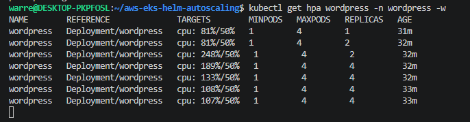

---

## Phase 7: Load Testing, Scale-Back-In & Ephemeral Storage

### Phase 7, Step 1: Redeploying WordPress, HPA & Telemetry Baseline
On a freshly provisioned `1.31` cluster, recreated the `wordpress` namespace, the `wordpress-db` `Secret`, the Helm release (with requests and limits), and the HPA, then confirmed cluster telemetry before testing.

```bash
helm upgrade --install wordpress ./helm/wordpress --namespace wordpress
kubectl rollout status deployment/wordpress -n wordpress --timeout=180s
kubectl apply -f k8s/wordpress-hpa.yaml
kubectl get all,hpa -n wordpress
kubectl top nodes
```

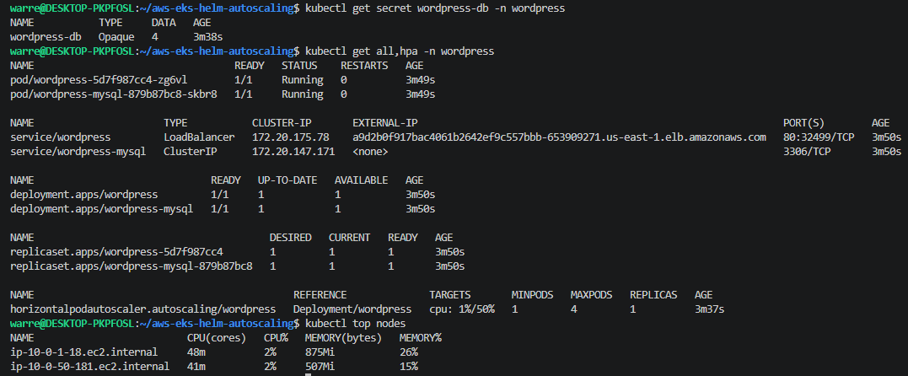

### Phase 7, Step 2: HPA Scale-Out, Scale-Back-In & MySQL `emptyDir` Verification
Drove concurrent HTTP load at the `LoadBalancer` endpoint and observed the HPA scale replicas above `1`, then cool back down once the load ended. Deleting the `wordpress-mysql` pod then wiped its `emptyDir` data, demonstrating why persistent storage is needed in Phase 8.

```bash
kubectl get hpa wordpress -n wordpress --watch
kubectl get pods -n wordpress -o wide
kubectl delete pod "$MYSQL_POD" -n wordpress
```

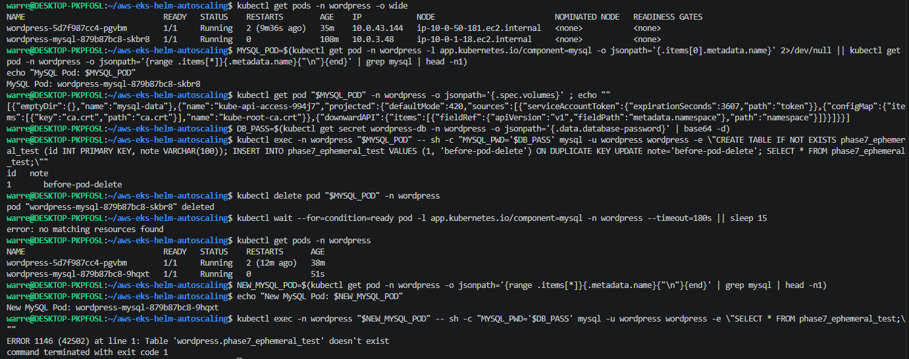

### Phase 7, Step 3: Cluster Teardown & Cost-Hygiene Verification
Removed the workload and its `LoadBalancer` service, deleted the cluster with `eksctl`, and audited leftover EC2 instances, load balancers, and CloudFormation stacks against `aws-eks-helm-autoscaling-budget`.

```bash
aws eks list-clusters --region us-east-1 --output table
aws ec2 describe-instances --region us-east-1 --filters "Name=instance-state-name,Values=pending,running,stopping,stopped" --query "Reservations[].Instances[].{InstanceId:InstanceId,Type:InstanceType,State:State.Name,Name:Tags[?Key=='Name']|[0].Value}" --output table
aws elbv2 describe-load-balancers --region us-east-1 --query "LoadBalancers[].{Name:LoadBalancerName,State:State.Code,Type:Type}" --output table
aws cloudformation list-stacks --region us-east-1 --stack-status-filter CREATE_COMPLETE UPDATE_COMPLETE UPDATE_ROLLBACK_COMPLETE --query "StackSummaries[?contains(StackName, 'eksctl') || contains(StackName, 'aws-eks-helm-autoscaling')].{StackName:StackName,Status:StackStatus}" --output table
```

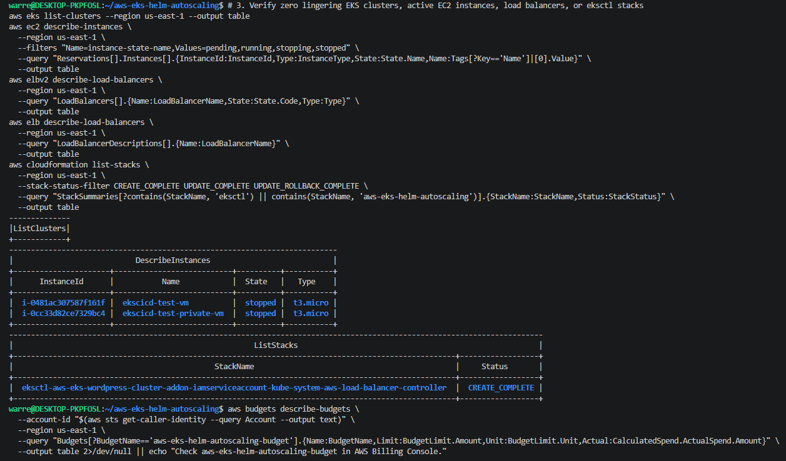

---

## Phase 8: Persistent Storage (`gp3` EBS) & WordPress Auth-Key Secret

### Phase 8, Step 1: Cluster Provisioning & Amazon EBS CSI Driver (`gp3` StorageClass)
Provisioned a new `1.31` cluster, associated its IAM OIDC provider, installed the `aws-ebs-csi-driver` add-on with the required IAM permissions, and created a `gp3` `StorageClass`.

```bash
aws eks describe-cluster --name aws-eks-helm-autoscaling-cluster --region us-east-1 --query "cluster.{name:name,version:version,status:status}" --output table
kubectl get pods -n kube-system -l app.kubernetes.io/name=aws-ebs-csi-driver
kubectl get storageclass
```

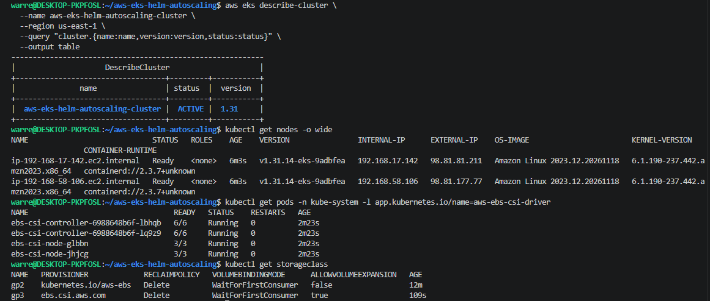

### Phase 8, Step 2: WordPress Auth-Key Kubernetes `Secret`
Created the `wordpress-auth-keys` `Secret` holding WordPress's authentication keys and salts, so login sessions stay valid no matter which autoscaled replica serves a request.

```bash
kubectl get secret wordpress-auth-keys -n wordpress
kubectl describe secret wordpress-auth-keys -n wordpress
```

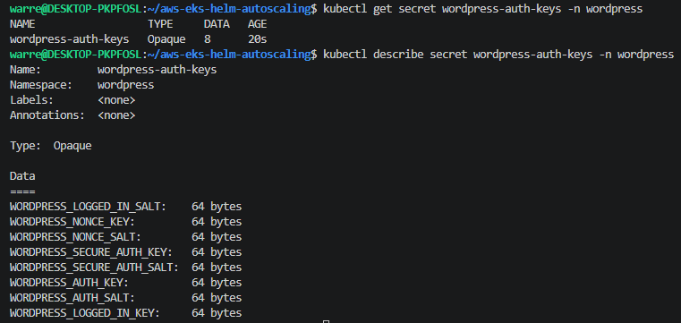

### Phase 8, Step 3: Helm Chart Updates for `gp3` Persistence & Auth-Key Injection
Updated `./helm/wordpress` with a `gp3` `PersistentVolumeClaim` (`wordpress-pvc`) and injected the eight keys and salts from `wordpress-auth-keys` into the WordPress pods, then validated the chart with `helm lint` and template rendering.

```bash
helm lint helm/wordpress
helm template wordpress ./helm/wordpress --namespace wordpress | grep -E "kind:|name:|storageClassName:|wordpress-auth-keys"
```

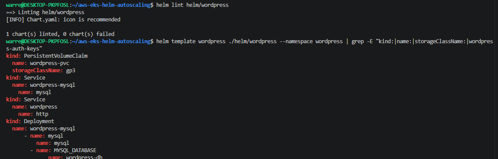

### Phase 8, Step 4: Deployment, PVC Binding & Auth-Key Verification
Deployed the updated release and confirmed that `wordpress-pvc` bound to a `gp3` volume, the WordPress pods became ready, and all eight auth keys and salts were wired into the deployment.

```bash
kubectl get pvc -n wordpress
kubectl get pods -n wordpress -o wide
kubectl get deployment wordpress -n wordpress -o jsonpath='{range .spec.template.spec.containers[0].env[*]}{.name}{" -> "}{.valueFrom.secretKeyRef.name}{":"}{.valueFrom.secretKeyRef.key}{"\n"}{end}' | grep "wordpress-auth-keys"
```

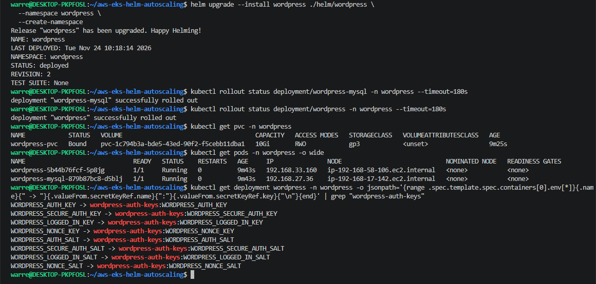

### Phase 8, Step 5: Persistence Verification Across Pod Recreation
Wrote a marker file to `/var/www/html/wp-content/uploads` on `wordpress-pvc`, deleted the running WordPress pod, and confirmed the file was still there in the replacement pod. Unlike the `emptyDir` test in Phase 7, the data survived.

```bash
kubectl get pvc -n wordpress
kubectl get pods -n wordpress -o wide
kubectl exec -n wordpress "$NEW_WP_POD" -- cat /var/www/html/wp-content/uploads/persistence-check.txt
```

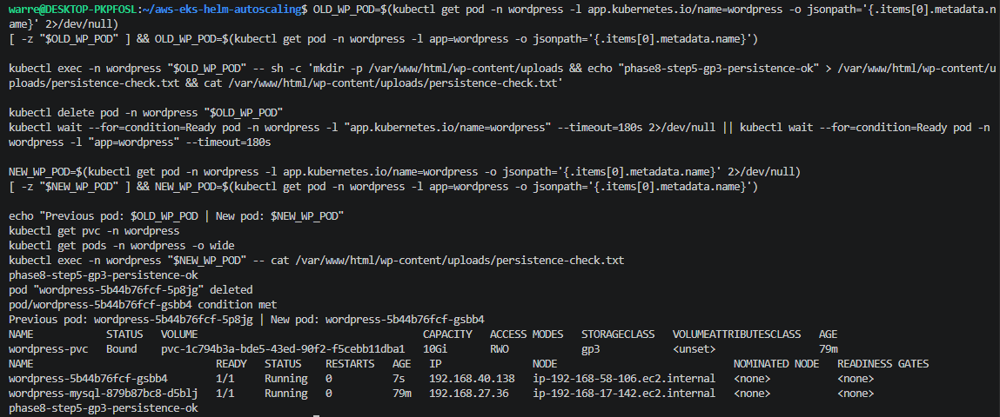

### Phase 8, Step 6: Cluster Teardown & Cost-Hygiene Verification
Removed the release and namespace, deleted the cluster, and verified that no EKS clusters, EC2 instances, or load balancers remained.

```bash
aws eks list-clusters --region us-east-1 --output table
aws ec2 describe-instances --region us-east-1 --filters "Name=instance-state-name,Values=pending,running,stopping,stopped" --query "Reservations[].Instances[].{InstanceId:InstanceId,Type:InstanceType,State:State.Name}" --output table
aws elbv2 describe-load-balancers --region us-east-1 --query "LoadBalancers[].{Name:LoadBalancerName,Type:Type,State:State.Code}" --output table
```

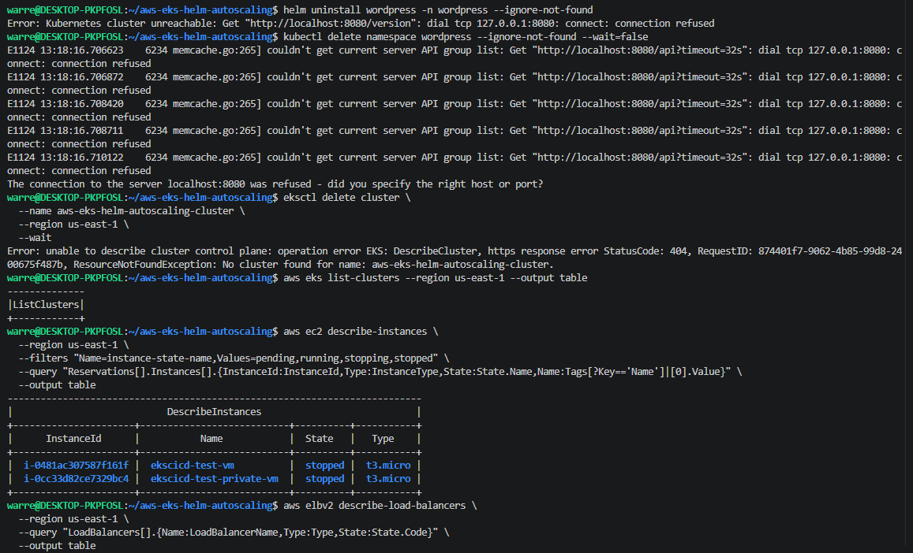

---

## Phase 9: HTTPS via ALB

### Phase 9, Step 1: AWS Load Balancer Controller via Helm with IRSA
Provisioned the cluster, associated its IAM OIDC provider, created an IAM Roles for Service Accounts (IRSA) service account for `aws-load-balancer-controller` in `kube-system`, and installed the controller with Helm.

```bash
kubectl get deployment -n kube-system aws-load-balancer-controller
kubectl get pods -n kube-system -l app.kubernetes.io/name=aws-load-balancer-controller -o wide
```

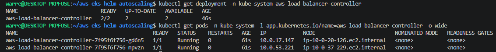

### Phase 9, Step 2: SSL/TLS Certificate in AWS Certificate Manager (ACM)
With no registered domain or DNS zone yet, requested a test certificate for `wordpress.aws-eks-helm-autoscaling.example`. Its status shows `FAILED` because DNS validation is impossible on a domain we don't own, but the step documents how ACM plugs into HTTPS (`443`) on an ALB.

```bash
aws acm list-certificates \
  --region us-east-1 \
  --query "CertificateSummaryList[].{DomainName:DomainName,Status:Status,KeyAlgorithm:KeyAlgorithm}" \
  --output table
```

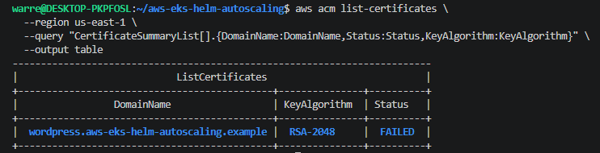

### Phase 9, Step 3: ALB Ingress Resource for HTTPS (Port 443)
Checked whether the `wordpress` namespace and `Service` existed (`Namespace wordpress not found yet`) and staged `k8s/wordpress-alb-ingress.yaml`, which routes HTTPS (`443`) traffic to the `wordpress` `Service` once an `ISSUED` certificate is available.

```bash
kubectl get namespace wordpress 2>/dev/null || echo "Namespace wordpress not found yet"
kubectl get svc -n wordpress 2>/dev/null || true
ls -lh k8s/wordpress-alb-ingress.yaml
```

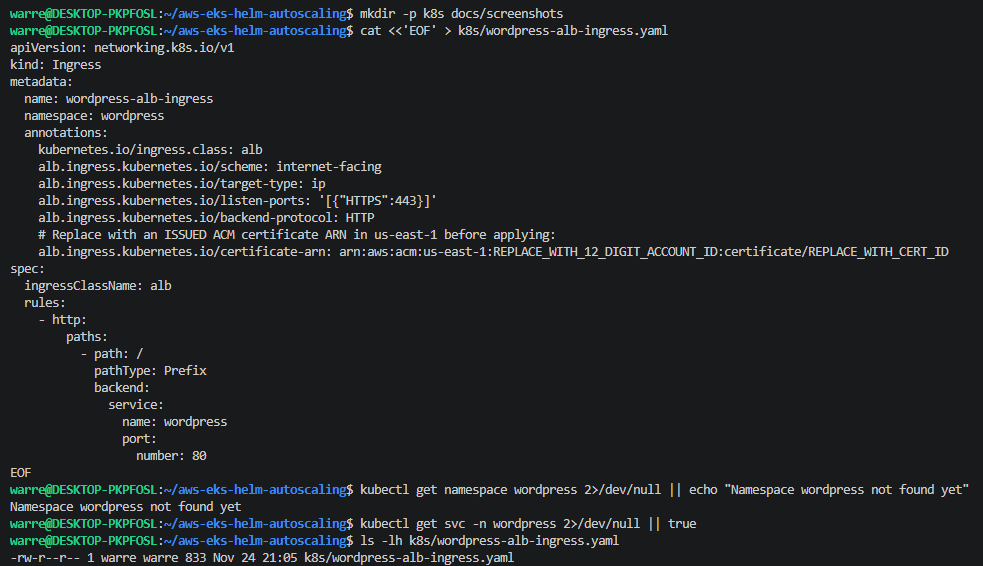

### Phase 9, Step 4: Encrypted Traffic Routing Readiness
Verified the controller deployment (`2/2` ready, pods `Running`), confirmed the `alb` `IngressClass` is available, and checked that the staged Ingress carries the HTTPS (`443`), `internet-facing`, and `ip` target-type annotations with placeholder values instead of a live ACM ARN.

Going live requires two things: deploying the `wordpress` namespace and `Service`, and an `ISSUED` ACM certificate in `us-east-1`.

```bash
kubectl get deployment -n kube-system aws-load-balancer-controller
kubectl get pods -n kube-system -l app.kubernetes.io/name=aws-load-balancer-controller -o wide
kubectl get ingressclass 2>/dev/null || true
kubectl get ingress -n wordpress 2>/dev/null || echo "No Ingress in namespace wordpress yet"
grep -nE "alb\.ingress\.kubernetes\.io/(listen-ports|certificate-arn|scheme|target-type)|name: wordpress" k8s/wordpress-alb-ingress.yaml
```

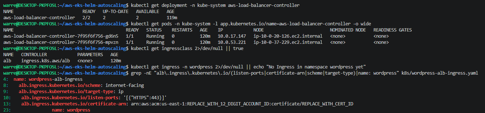

---

## Phase 10: Documentation, Polish & Comparison

### Phase 10, Step 0: Cluster Teardown & Cost-Hygiene Verification
Deleted the cluster (`all cluster resources were deleted`) and verified that no EKS clusters, load balancers, or running/pending EC2 instances remained against the $10/month budget.

```bash
eksctl delete cluster --name aws-eks-helm-autoscaling-cluster --region us-east-1 --wait
aws eks list-clusters --region us-east-1
aws elbv2 describe-load-balancers --region us-east-1 --query 'LoadBalancers[].LoadBalancerName'
aws ec2 describe-instances --region us-east-1 --filters "Name=instance-state-name,Values=running,pending" --query 'Reservations[].Instances[].InstanceId'
```

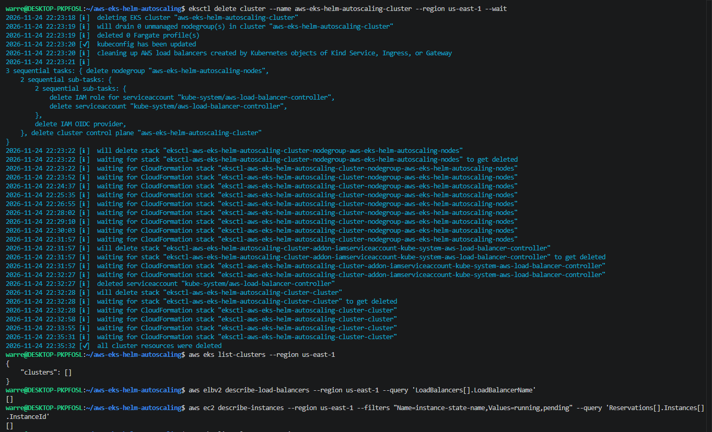

### Phase 10, Step 1: End-to-End Architecture & Lifecycle Synthesis
`aws-eks-helm-autoscaling` is a cloud-native portfolio project covering Kubernetes deployment, autoscaling, persistence, and encrypted ingress in `us-east-1`. It brings together `eksctl` (EKS cluster `aws-eks-helm-autoscaling-cluster` on public subnets, no NAT Gateway, `t3.medium` nodes), a custom Helm chart (`./helm/wordpress`), Kubernetes autoscaling, storage, and secret manifests, and AWS Load Balancer Controller / ACM ingress preparation (`k8s/wordpress-alb-ingress.yaml`).

- **Foundations & Tooling (Phases 1–3):** Set up WSL2, Git, and GitHub; created the `aws-eks-helm-autoscaling-admin` IAM user and a $10/month budget; and practiced core Kubernetes objects on a local `kind` cluster.
- **Cluster & Helm Packaging (Phases 4–5):** Provisioned the EKS cluster from `eksctl/cluster-config.yaml` and packaged WordPress + MySQL under `./helm/wordpress` (`Chart.yaml`, `values.yaml`, and deployment/service/PVC templates), with database credentials in the `wordpress-db` `Secret` (`k8s/wordpress-db-secret.yaml`).
- **Telemetry & Horizontal Autoscaling (Phases 6–7):** Enabled `metrics-server`, set CPU requests and limits, and applied `k8s/wordpress-hpa.yaml` to prove scale-out under load and scale-back-in once load subsides. Also showed that `emptyDir` storage loses data when a pod is deleted.
- **Persistent Storage & Secrets (Phase 8):** Added EBS `gp3` storage (`k8s/gp3-storageclass.yaml` and `templates/wordpress-pvc.yaml`) and the `wordpress-auth-keys` `Secret`, keeping credentials out of images and preserving data across pod restarts.
- **HTTPS via ALB Readiness (Phase 9):** Configured OIDC and IRSA for the AWS Load Balancer Controller, evaluated ACM validation (`FAILED` on an unowned test domain), and staged the HTTPS Ingress with placeholder account and certificate values.
- **Teardown & Cost Hygiene (Phases 7, 8, and 10):** Deleted the cluster at the end of each working session and verified that no billable EKS, EC2, or load balancer resources remained.

## Phase 10, Step 2: Architectural Trade-Offs, Cost Analysis & Platform Comparison

### Key Architectural Trade-Offs (`aws-eks-helm-autoscaling` in `us-east-1`)
- **Public Subnets Without NAT Gateway vs. Private Worker Subnets:** Using public subnets with no NAT Gateway avoided ~$32.85/month per NAT Gateway in hourly `us-east-1` charges (~$0.045/hr plus $0.045/GB data processing), helping stay within `aws-eks-helm-autoscaling-budget` ($10/month). Production clusters place worker nodes in private subnets with NAT Gateways or VPC endpoints while keeping only the `internet-facing` ALB in public subnets.
- **EBS `gp3` PVC Persistence vs. Managed RDS & Shared Media Storage:** Attaching an EBS `gp3` PVC (`k8s/gp3-storageclass.yaml` and `templates/wordpress-pvc.yaml`) with Secrets (`wordpress-db` and `wordpress-auth-keys`) preserved state across pod restarts for a single MySQL instance. Production multi-replica WordPress with HPA (`k8s/wordpress-hpa.yaml`) benefits from managed Amazon RDS (Multi-AZ) for the database and shared `ReadWriteMany` storage (such as Amazon EFS) for `wp-content/uploads`.
- **Staged ALB Ingress (`k8s/wordpress-alb-ingress.yaml`) & TLS Readiness:** Keeping `k8s/wordpress-alb-ingress.yaml` (`HTTPS: 443`, `internet-facing`, `ip` target type) staged with placeholder account/certificate values until an `ISSUED` ACM certificate in `us-east-1` is available prevented failed TLS reconciliations and avoided orphaned load-balancer spend.
- **Session Teardown Hygiene:** Running `eksctl delete cluster --name aws-eks-helm-autoscaling-cluster --region us-east-1 --wait` between sessions eliminated ongoing EKS control-plane ($0.10/hr) and `t3.medium` node charges (`all cluster resources were deleted`).

### Approach & Platform Comparison

| Dimension | Terraform EC2 Lift-and-Shift | `aws-eks-helm-autoscaling` (EKS `1.31` Lab) | Production Managed Cloud-Native (EKS / ECS) |
| :--- | :--- | :--- | :--- |
| **Deployment & Packaging** | Terraform IaC on single EC2 VM | Helm (`./helm/wordpress`) + K8s manifests (`k8s/`) | Helm / GitOps + automated CI/CD rollouts |
| **Autoscaling** | Manual / EC2 Auto Scaling group | HPA (`k8s/wordpress-hpa.yaml`) + cluster nodes | Multi-metric HPA + Karpenter / Cluster Autoscaler |
| **Database & Storage** | Local VM / standalone DB | MySQL + EBS `gp3` PVC + K8s Secrets | Amazon RDS Multi-AZ + EFS (`ReadWriteMany`) + Secrets Manager |
| **Networking & TLS** | EC2 security group + CloudFront/ALB | IRSA + ALB Controller + staged `Ingress` (`443`) | Private subnets + NAT/endpoints + ACM DNS validation + WAF |
| **Cost & Lifecycle Hygiene** | `terraform destroy` between runs | `eksctl delete cluster --wait` + $10/mo budget | Continuous HA runtime + version upgrade planning |

## Phase 10, Step 3: Full Repository, Link, Secret & Privacy Audit
We verified all 33 image links in `README.md` resolve to non-empty PNG files under `docs/screenshots/` (`Missing/empty count: 0`), confirmed zero `AKIA` keys or real ACM ARNs in tracked files, verified `k8s/wordpress-alb-ingress.yaml` uses placeholder tokens (`REPLACE_WITH_12_DIGIT_ACCOUNT_ID` and `REPLACE_WITH_CERT_ID`), and confirmed no non-placeholder 12-digit numbers exist in tracked files.

## Phase 10, Step 4: Final GitHub Publication 
We finalized `README.md` across Phases 1–10, pushed all updates to `origin/main`, and verified cluster teardown and cost-hygiene checks in `us-east-1` (`all cluster resources were deleted`, zero active EKS clusters, load balancers, or running/pending EC2 instances).